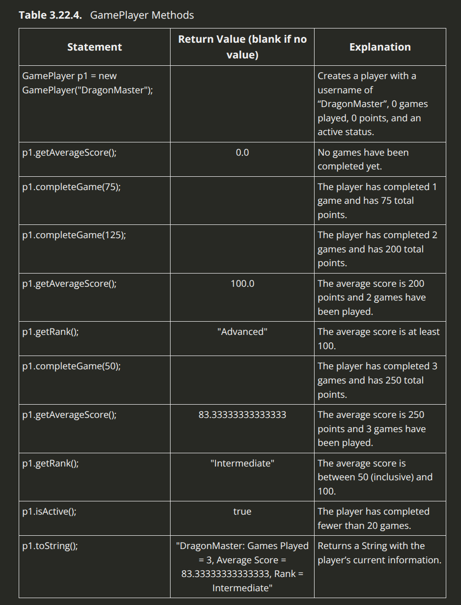

# Game Player
An online game tracks information about each player’s performance. A GamePlayer object stores a player’s username, the number of games played, the total number of points earned, and whether the player is currently active.
The class should provide methods that allow a program to:
- Create a new GamePlayer object
- Complete a game where it adds the given number of points to totalPoints, increases gamesPlayed by 1, and if the player has completed 20 or more games, set active to false.
- Change the player’s status to active
- Get the player’s average score (if the player has not completed any games, return 0.0)
- Get the rank of the player:
  - Beginner if the average score is less than 50.
  - Intermediate if the average score is at least 50 but less than 100.
  - Advanced if the average score is 100 or higher.
    - Note: This method must call the method for averaging the score correctly to receive full points
- Get the status of the player (active or not)
- Prints the player object in the form: <username>: Games Played = <gamesPlayed>, Average Score = <average>, Rank = <rank>
  - This method must call the appropriate methods for the average and the rank to receive full points

The following table shows examples of calls to methods in the GamePlayer class.
